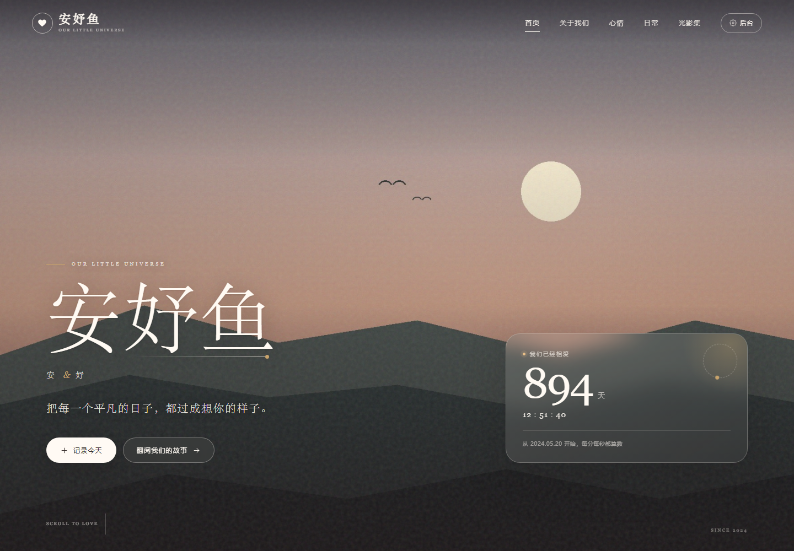
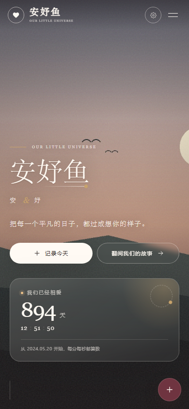
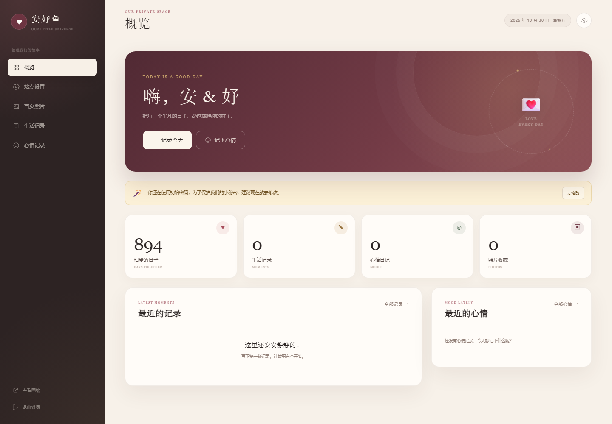

# 安妤鱼 · 我们的恋爱小屋

一个只属于两个人的恋爱记录网站。可以记下每天的心情，用文字、照片、语音、视频收藏日常，也能在首页看到相爱的天数、心情气象和照片墙。



| 手机首页 | 后台概览 |
| --- | --- |
|  |  |

---

## 一、怎么打开

1. 双击项目文件夹里的 **`启动网站.bat`**。
2. 稍等两秒，浏览器会自动打开：
   - 首页：<http://localhost:3210>
   - 后台：<http://localhost:3210/admin>
3. 后台初始密码：**`anyu520`**

> 第一次打开后，建议先做三件事：改恋爱开始日期、改名字、改后台密码。

如果浏览器没有自动打开，手动在地址栏输入 `http://localhost:3210` 即可。

---

## 二、第一次使用，先设置这些

进入后台 → **站点设置**：

| 项目 | 说明 |
| --- | --- |
| 网站名称 | 默认「安妤鱼」，可以改成你们喜欢的名字 |
| 恋爱开始日期 | **重要！** 首页的相爱天数从这一天开始算，默认 2024-05-20 只是占位，请改成你们真正的纪念日 |
| 你的名字 / TA 的名字 | 首页、页脚、结尾都会显示 |
| 首页小标题 / 首页一句话 | 首页大标题下方的文字 |
| 关于我们 · 引言 | 「关于我们」板块的引言 |
| 页脚落款 | 网站最下方的一行小字 |

保存后首页立即更新。

然后在 **首页照片** 上传你们的照片：

- **首页轮播**：出现在网站最上方，可以上传多张，自动轮播。
- **光影集**：首页的照片墙，也可以放多张。
- 没有上传轮播照时，网站会使用一张默认的落日插画。

照片支持 JPG / PNG / WebP / GIF / AVIF，单张不超过 150MB。上传后可以改照片说明、调整顺序、在轮播和光影集之间移动、删除。

最后去 **站点设置 → 修改后台密码**，把初始密码 `anyu520` 改掉。修改后需要重新登录。

---

## 三、怎么记录

### 1. 记录每天心情

后台 → **心情记录**：

1. 选择日期（默认今天）。
2. 点一个心情表情：开心 / 甜蜜 / 平静 / 想念 / 疲惫 / 难过 / 小情绪。
3. 可以写一句当天的心情悄悄话。
4. 保存。

同一天保存多次会覆盖成最后一次。首页的「心情气象站」会自动显示今天的心情、最近的心情颜色和心情日历；点日历里带表情的日期，可以看到那天的心情和文字。

### 2. 记录每日生活

后台 → **生活记录**：

1. 选择日期。
2. 选一个当天心情（可以不选）。
3. 写标题和想说的话。
4. 添加附件：
   - **照片 / 视频**：一次可以选多个文件。
   - **上传语音**：选择手机或电脑里已有的录音文件。
   - **直接录音**：点一下开始录音，再点一下停止，录好的声音会自动加入附件。需要浏览器允许麦克风权限。
5. 点「保存这一刻」。

附件支持：

- 图片：JPG / PNG / WebP / GIF / AVIF
- 音频：MP3 / WAV / OGG / WebM / M4A / AAC
- 视频：MP4 / WebM / MOV / M4V
- 单个文件上限 150MB，一次最多 12 个新附件

保存后的记录会出现在首页「我们的日常」时间线里。可以按「文字 / 照片 / 语音 / 视频」筛选，点照片可以看大图。

在后台的记录列表里，可以随时 **编辑文字和心情**、**删除单条记录**；编辑状态下，已经保存的附件也可以单独删除。

---

## 四、手机怎么用

网站在手机上是完整的响应式布局：首页、心情、时间线、照片墙、后台都可以直接在手机浏览器里操作。

1. 让手机和电脑连接 **同一个 Wi-Fi**。
2. 双击 `启动网站.bat`，在黑色窗口里找到这一行：

   ```
   手机访问（同一 Wi-Fi）：http://192.168.x.x:3210
   ```

3. 在手机浏览器打开这个地址即可。
4. 如果手机打不开：
   - 检查电脑和手机是否在同一个 Wi-Fi；
   - Windows 首次启动时如果弹出防火墙提示，请选择「允许访问」；
   - 手机地址必须是电脑的局域网 IP，不能用 `localhost`。

**关于手机录音：**

- 手机通过 `http://192.168...` 访问时，很多浏览器会禁止网页直接调用麦克风。
- 这时可以点 **「上传语音」**，选择手机里已经录好的语音文件，同样可以保存成语音记录。
- 在电脑本机打开 `http://localhost:3210` 时，可以直接录音。
- 如果一定想在手机上直接录音，需要给网站配置 HTTPS（不在默认安装范围内）。

---

## 五、数据放在哪里 / 怎么备份

所有文字和设置都在：

```
data/anyu.db
```

所有上传的照片、语音、视频都在：

```
data/uploads/
```

**备份方法：** 关闭网站窗口，把 `data` 整个文件夹复制到 U 盘或网盘即可。恢复时把 `data` 文件夹放回原位。

**注意：** 不要删除 `data` 文件夹，否则记录会全部丢失。

---

## 六、忘记后台密码怎么办

1. 先关闭正在运行的网站窗口。
2. 双击 **`重置密码.bat`**。
3. 按提示输入新密码（至少 6 位），直接回车则重置为 `anyu520`。
4. 重新双击 `启动网站.bat`，用新密码登录。

也可以在命令行里运行：

```bash
node scripts/reset-password.js 你的新密码
```

---

## 七、常见问题

**网站打不开 / 端口被占用？**

默认端口是 `3210`。如果这个端口已被其他程序占用，可以在命令行里先设置端口再启动：

```bat
set PORT=3211
启动网站.bat
```

然后访问 `http://localhost:3211`。

**照片或视频上传失败？**

- 检查格式是否在支持列表里；
- 单个文件不能超过 150MB；
- 一次最多添加 12 个新附件；
- 手机拍摄的视频有时超过 150MB，可以先压缩，或把长视频剪短。

**首页还是默认的落日插画？**

说明还没有上传「首页轮播」照片。去后台 → 首页照片，把分类选成「首页轮播」再上传。

**首页的相爱天数不对？**

去后台 → 站点设置，把「恋爱开始日期」改成真正的纪念日。修改后刷新首页。

**手机录音按钮是灰的？**

手机通过局域网 HTTP 访问时浏览器会禁用麦克风，这是浏览器的安全限制。请改用「上传语音」，或让网站在电脑本机使用。

**这个网站能放到公网吗？**

默认面向家庭局域网使用。如果要放到公网，请先配置 HTTPS、反向代理和更强的密码，并做好数据备份。不要把默认密码直接暴露在公网上。

---

## 八、技术说明

- Node.js 24+（使用内置 SQLite，不需要额外数据库）
- Express 5 + Multer
- 原生 HTML / CSS / JavaScript，无前端构建步骤
- 数据：`data/anyu.db`
- 上传文件：`data/uploads/`
- 默认端口：`3210`

项目结构：

```
情侣网站/
├─ 启动网站.bat          # 双击启动
├─ 重置密码.bat          # 忘记密码时使用
├─ server.js             # 网站服务端
├─ public/
│  ├─ index.html         # 首页
│  ├─ admin.html         # 后台
│  ├─ css/               # 样式
│  ├─ js/                # 页面逻辑
│  └─ assets/            # 图标和默认封面
├─ data/                 # 数据库和上传文件（重要，注意备份）
└─ scripts/              # 重置密码等辅助脚本
```

---

愿你们把每一个普通的日子，都过成以后想起来会笑的日子。

**安妤鱼 · Our Little Universe**
